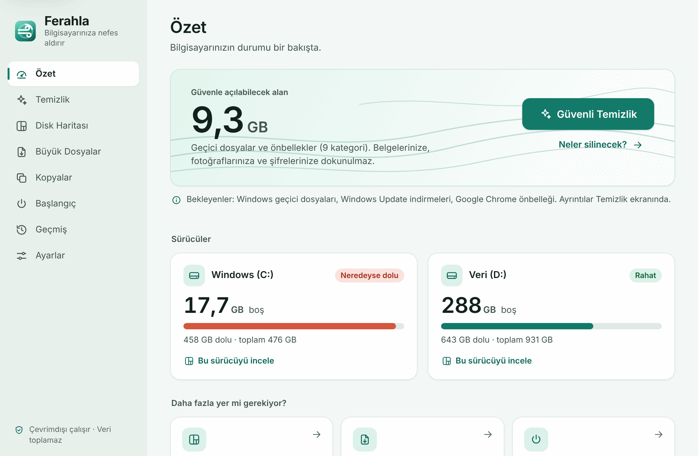
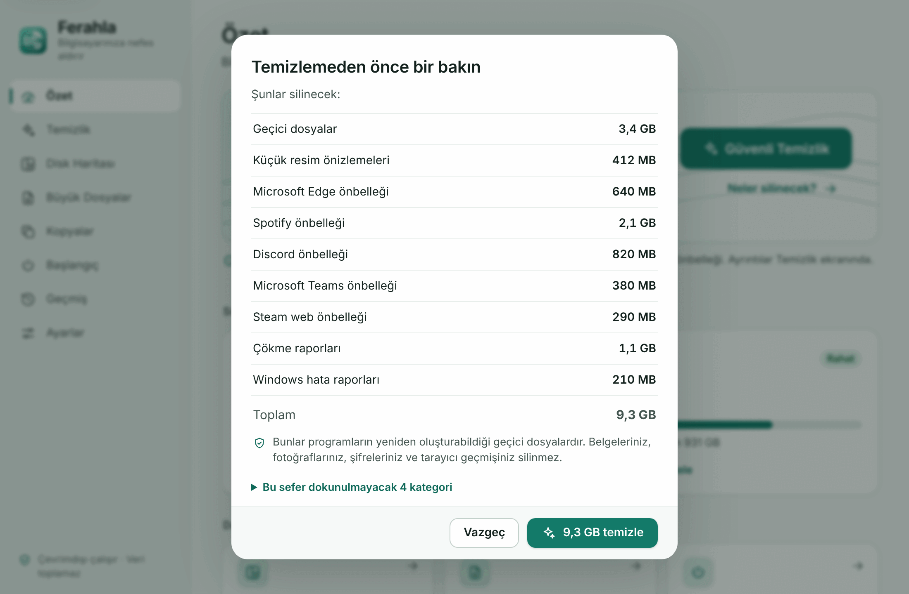
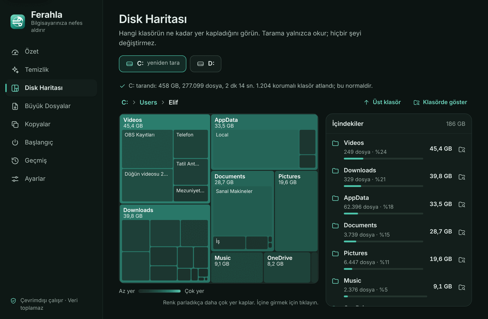
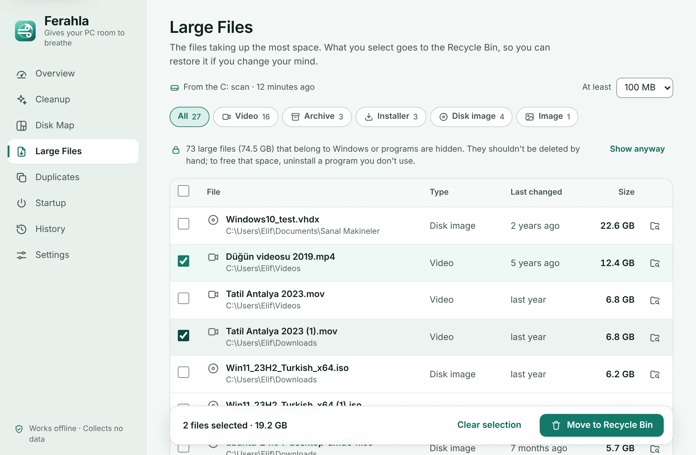

# Ferahla — Tasarım

Hedef kullanıcı teknik olmayan biri: "C: kırmızıya döndü, ne silebilirim, bir şeyi bozar mıyım?" Arayüzün asıl işi **güven vermek**.
Kimlik: *ferah, nefes alan* — bol boşluk, nane/deniz yeşili, yumuşak köşeler, esinti çizgileri. Alarm yok, ünlem yok.

## 1. İlkeler
1. **Güven — siz onaylamadan hiçbir şey olmaz.** Her silme bir onay penceresinden geçer; pencere *tam olarak* neyin, ne kadarının
   silineceğini ve neyin bu sefer **dokunulmadan** bırakıldığını (ve nedenini) listeler.
2. **Tehlikeli hiçbir şey varsayılan seçili değil.** Geri Dönüşüm Kutusu (kalıcı kayıp), yönetici gerektirenler, uygulaması açık olanlar,
   kopya dosyalar ve büyük dosyalar kendiliğinden seçilmez. Kopyalarda her gruptan biri **"Tutulacak"** olarak kilitlidir ve asla gönderilmez.
3. **Açıklık.** Her kategoride "Bu ne?" → *ne olduğu + silinirse ne olacağı*. Başlangıç öğelerinde "Kapatılabilir / Kapatmayın / Bilinmiyor"
   rozeti + bir cümle. Teknik ayrıntı (komut, kayıt defteri) yalnızca istenirse ("Teknik ayrıntılar").
4. **Geri alınabilirlik.** Kullanıcı dosyaları yalnızca **Geri Dönüşüm Kutusu'na taşınır** (düğme metni asla "kalıcı sil" değil); dürüstçe
   "Diskte yer, kutu boşaltıldığında açılır" denir. Başlangıç değişiklikleri Geçmiş'ten tek tıkla geri alınır.
5. **Sakin dil, alarmcılık yok.** "347 SORUN BULUNDU!" yerine "Güvenle açılabilecek alan: 9,3 GB". Sürücü durumu renkle *ve* sözle:
   "Rahat / Dolmaya başlıyor / Neredeyse dolu". Atlanan kilitli dosyalar "Bu normaldir" diye açıklanır.
6. **Korunan şeyler görünür ama dokunulmaz.** Windows/Program Files/oyun dosyaları büyük dosya listesinde varsayılan gizli
   ("73 dosya gizlendi — elle silinmemeli; programı kaldırın"); gösterilirse kilit simgesiyle, seçilemez.

## 2. Token'lar (`src/renderer/styles.css` :root)
| Grup | Açık | Koyu | Not |
|---|---|---|---|
| Zemin / kenar menüsü / yüzey | `#F3F7F5` / `#E8F0EC` / `#FFFFFF` | `#0C1412` / `#0F1916` / `#141F1C` | Nane tonlu, saf gri değil |
| Metin 1 / 2 / 3 | `#13211D` / `#435550` / `#5B6C66` | `#E3EDE9` / `#AFBFB9` / `#92A49D` | Hepsi yüzeyde ≥ 4.5:1 (ölçüldü) |
| Vurgu (düğme) / vurgu metni | `#137A69` / `#0D6858` | `#4CC3A9` / `#6ED5BD` | Düğme metni beyaz 5.2:1 · koyu 7.5:1 |
| Durum: rahat / dolmaya başlıyor / neredeyse dolu | `#137A69` / `#D98E1C` / `#D4563D` | `#4CC3A9` / `#E0A33A` / `#E8775F` | Çubuk ≥ 3:1; eşik %80 / %90 veya < 10 GB boş |
| Bilgi (yönetici) / "Kapatmayın" | `#E5EFF9`+`#23518A` / `#E5ECF8`+`#2B4C84` | koyu karşılıkları | Mavi = bilgi, kırmızı değil |
| Treemap rampası (paya göre) | `#E6F4EF → #176E60` | `#1B2925 → #5CC6AE` | Karekök ölçek; metin rengi her hücrede kontrasta göre seçilir |

- **Tipografi:** `"Segoe UI Variable Text", "Segoe UI Variable", "Segoe UI", sans-serif` (başlık/büyük rakam: `…Display`). Harici font yok.
  Ölçek 12 / 13 / 14 (gövde) / 15 / 18 / 26 (ekran başlığı) / 34–56 (büyük rakam, `tabular-nums`, birim %42 boyutta).
- **Boşluk:** 4'ün katları (4–40). Ekran kenar boşluğu 28/36 px (dar: 22/24). **Köşe:** 8 / 10 (düğme) / 16 (kart) / 20 (diyalog).
- **Boyut biçimi:** 1024 tabanlı (Gezgin ile aynı), TR "1,4 GB", EN "1.4 GB"; <10 ise 1 ondalık.
- Koyu tema iki yerde aynı değerlerle: `prefers-color-scheme` (ayar = Sistem) ve `:root[data-theme="dark"]`.

## 3. Ekranlar ve akışlar
| Ekran | İçerik | Akış |
|---|---|---|
| **Özet** | Hoş geldiniz kartı (ilk açılış), *Güvenle açılabilecek alan* (büyük rakam + tek "Güvenli Temizlik"), "Bekleyenler" notu, sürücü kartları (boş alan büyük, doluluk çubuğu, durum rozeti, "Bu sürücüyü incele"), 3 kısayol döşemesi | Güvenli Temizlik → onay penceresi (liste, toplam, "Bu sefer dokunulmayacak N kategori") → Temizlik ekranında ilerleme → **"Bilgisayarınız 9,2 GB ferahladı"** sonuç ekranı |
| **Temizlik** | Windows / Tarayıcılar / Uygulamalar grupları; satır: onay kutusu, ad, rozetler (Yönetici izni gerekir, Geri getirilemez), boyut + öğe sayısı, "Bu ne?" açılır açıklama; yönetici/uygulama-açık notu + "Yeniden kontrol et"; yapışkan seçim çubuğu | Önerilenleri seç / Hiçbirini seçme → Temizle → aynı onay |
| **Disk Haritası** | Sürücü seçici, canlı tarama paneli (dosya, boyut, geçen süre, şu anki klasör, İptal), squarify treemap (2 seviye; tek-çocuk zincirleri açılır: "Users › Elif"), ekmek kırıntısı, "Üst klasör", "Klasörde göster", yanında boyuta göre sıralı liste | Hücre/satır tıkla → içine gir; liste satırına gelince haritada vurgulanır (ve tersi); Alt+← / Backspace üst klasör |
| **Büyük Dosyalar** | Tür çipleri (sayılı), "En az" (100 MB–5 GB), tablo (tür ikonu, ad + klasör, tür, son değişiklik, boyut, klasörde göster), korunanlar gizli | Seç → "Geri Dönüşüm Kutusu'na taşı" → onay (odak *Vazgeç*'te) → bildirim + "Geri Dönüşüm Kutusu'nu aç" |
| **Kopyalar** | Açıklayıcı giriş kartı → karşılaştırma ilerlemesi → grup kartları (en eski kopya "Tutulacak", diğerlerinde "Bunu tut") | "Tüm fazla kopyaları seç" → taşı (tutulacaklar istemci tarafında da süzülür) |
| **Başlangıç** | Özet şeridi (açılışta başlayan / kapatılabilir), Kapatılabilir → Bilinmiyor → Kapatmayın grupları, avatar, rozet, açıklama, anahtar (role=switch) + "Açılışta başlar/Başlamaz" | "Kapatmayın" öğesini kapatmak → uyarı penceresi; güvenli seçenek (*Vazgeç*) birincil |
| **Geçmiş** | Güne göre zaman çizelgesi, toplam temizlenen | Taşıma → "Geri Dönüşüm Kutusu'nu aç"; başlangıç → "Geri al"; geri alınmış → "Geri alındı" rozeti |
| **Ayarlar** | Dil (Türkçe/English), Tema (Sistem/Açık/Koyu), hariç tutulan klasörler (ekle/kaldır; `pickFolder` varsa "Klasör seç…"), Hakkında (çevrimdışı, veri toplamaz, yönetici durumu) | Değişiklik anında uygulanır |

## 4. Durumlar
- **İlk açılış:** Karşılama kartı ("Siz onaylamadan hiçbir şey silinmez" vb. üç madde) + "Anladım" (tercih `localStorage`'da).
- **Yükleniyor:** iskelet bloklar (`aria-busy`, hareketi azalt'ta animasyonsuz).
- **Taranıyor:** canlı sayaçlar `aria-live` dışında (gürültü yapmaz); başlangıç/bitiş/iptal ekran okuyucuya duyurulur. Kenar menüsünde nokta.
- **Boş:** "Her şey zaten ferah", "Kopya bulunamadı — dosyalarınız düzenli görünüyor", "Henüz bir işlem yapılmadı" (esinti illüstrasyonu).
- **Tarama gerekli:** Büyük Dosyalar/Kopyalar'da "Önce bir sürücüyü tarayalım" + sürücü düğmeleri.
- **Hata:** sakin kart "Bir şeyler yolunda gitmedi" + ne olduğu + "Hiçbir dosyaya dokunulmadı" + Tekrar dene. Tarama hata kodları
  (`not-found`, `access-denied`, `scan-failed`) Türkçe cümleye çevrilir.
- **Yönetici gerekli:** satır devre dışı, mavi "Yönetici izni gerekir" rozeti, kilit simgeli neden; sayfa başında nasıl yapılacağı.
- **Uygulama/tarayıcı açık:** satır devre dışı, amber not ("Önce Chrome'u kapatın…") + "Yeniden kontrol et".
- **Kullanımda atlananlar:** sonuçta "17 dosya şu an kullanıldığı için atlandı. Bu normaldir…".

## 5. Erişilebilirlik
- Tam klavye: tüm eylemler gerçek `<button>`/`<input>`; görünür 2 px odak halkası (`:focus-visible`), "İçeriğe geç" bağlantısı,
  ekran değişince odak `h1`'e (tabindex −1, halka gösterilmez), Ctrl+1…8 ekranlar arası.
- Diyaloglar yerel `<dialog>` (odak tuzağı, Esc); açan öğeye odak geri döner. Riskli onaylarda ilk odak *Vazgeç*'te.
- `aria-current="page"` (menü), `aria-current="location"` (ekmek kırıntısı), `aria-expanded/controls` ("Bu ne?"), `role="switch"`,
  `aria-pressed` (çipler), `role="progressbar"/"meter"`, `aria-describedby` ile devre dışı nedeni.
- Durum mesajları `role="status" aria-live="polite"` (bildirimler + gizli duyuru alanı).
- **Treemap'in alternatifi yanındaki listedir** (aynı veri, sıralı, klavyeyle gezilir); SVG `role="img"` ve açıklayıcı etiket taşır.
- Renk tek başına anlam taşımaz: her durum renginin yanında söz (rozet), paylar yüzde olarak da yazılır.
- WCAG AA: tüm metin token çiftleri ≥ 4.5:1, bileşen sınırları ≥ 3:1 (betikle ölçüldü). `prefers-reduced-motion` ve
  Windows yüksek karşıtlık (`forced-colors`) desteklenir.
- Pencere: 1100×720 varsayılan, 800×560'a kadar düzgün (≤960 px'te kenar menüsü ikon moduna geçer, etiketler ekran okuyucuya kalır).

## 6. Uygulama ikonu
`assets/icon.svg` (+ `icon-256.png`, `icon-512.png`, arayüz kopyası `src/renderer/logo.svg`): nane→deniz yeşili yuvarlak kare üzerinde
**çoğu boş (soluk) bir disk halkası**, küçük dolu yayı ve içinden geçen **esinti** — "diskiniz nefes alıyor".

## 7. Dosyalar ve önizleme
`index.html` (CSP: `default-src 'self'; img-src 'self' data:; style-src 'self' 'unsafe-inline'`), `styles.css`, `app.js`, `i18n.js`,
`treemap.js` (squarify, harici kütüphane yok), `icons.js` (çizgi ikonlar), `mock-api.js`.
Tarayıcıda önizleme: `src/renderer/index.html` doğrudan açılır; `window.ferahla` yoksa mock devreye girer.
Seçenekler: `?mock=scanned,fast` (C: taranmış), `admin`, `fresh` (ilk açılış), `caterror`, `scanerror`, `clean` (boş durum); `#map` gibi
bir çapa ile doğrudan ekrana gidilir. Ekran görüntüleri Inter ile alındı (konteynerde Segoe UI yok).

| | |
|---|---|
|  |  |
|  | |
